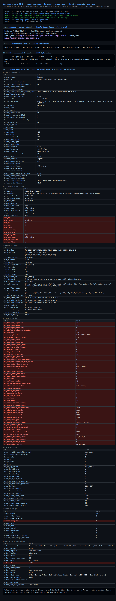

# Verisoul Web SDK — Client-Side Red Team

**Executive write-up · 2026-10-25 · authorized, own-stack only · public assets
+ local instrumentation · NO telemetry forwarded to Verisoul**

> **One line:** Verisoul ships a genuinely good server-issued, per-fetch
> session token — but the device-intelligence blob it's wrapped around
> (`dd`) is **not encryption**: it's a 32-byte-period XOR obfuscation whose
> **16-byte key is prepended to the blob in cleartext**. We recovered the
> cipher from the obfuscated bundle, **validated the decrypt to 100%**, and
> read the full **195-field** device/bot-detection payload with original key
> names.

---

## What we accomplished

1. **Mapped the deployment + token model.** Two-stage loader:
   `js.verisoul.ai/{env}/bundle.js` → `sandbox.js.verisoul.ai` → fetches
   `bhve.js` (WebSocket behavioral engine) + `/network-signals/tls/frame`.
   Every bundle fetch returns a **fresh, server-minted preamble**
   (`session_token`, `build_token`, `stun_token`, `cf_token`, `generation`,
   TTLs) — real per-fetch anti-replay state the client can't forge.
2. **Read the telemetry envelope in plaintext.** `/collect` ships
   `project_id, bundle_id, session_token, build_token, token_generation,
   ice_candidates` as clear JSON; opaque parts are the `dd` blob and the
   `stun` blob to `cf-enrich`.
3. **Broke the `dd` cipher.** Recovered from the obfuscated bundle:
   ```
   dd = b64( u[16] || ( random16 || JSON(QZ-renamed device_data) ) XOR keystream )
   keystream[s] = splitmix32(per-build seed)[s%32] XOR u[s%16]
   u = crypto.getRandomValues(16)   ← the per-run key, PREPENDED IN CLEARTEXT
   QZ = hardcoded 197-entry key-rename map
   ```
   **Validated 100%** (byte-exact) against a same-run capture.
4. **Recovered the full readable payload** — **195 fields, original keys**
   (via a `JSON.stringify` boundary hook): GPU/WebGL, emoji/font/CSS
   fingerprints, worker-realm cross-checks, and the entire `bot_*`
   detection surface: `bot_webdriver`, CDP probes, dev-tools-open,
   CefSharp/Playwright/Selenium checks, iframe tampering counts, canvas-jpeg
   support, HWID `no-adapter`, DRM matrix, `privacy_incognito`, …

## How we did it (methodology)

- **Offline string-table decode** — the decoder
  (`atob` ⊕ FNV-seeded per-position keystream) was extracted and run in Node:
  1,755 strings. The decoder seed is keyed to real DOM values
  (`screen.pixelDepth`, `Node.*`, `XHR.DONE`, `Element.name`) — a subtle
  integrity cross-check.
- **Structural runtime hooks** (per-delivery obfuscation rotates identifiers
  *and* constants every fetch, so anchors must be structural): patched the
  string decoder to capture all 1,281 (index → string) decodes; captured call
  stacks to locate the collect-body assembly and the encoder `cR`;
  hooked `JSON.stringify` to capture the device object **before** renaming.
- **Cipher validation:** same-run `dd` vs known plaintext →
  `E[s]⊕P[s]` is exactly periodic (32) at offset 16 → **100% byte match**.

## What it proves

- The client can read **and rewrite** everything Verisoul's SDK ships:
  the envelope is plaintext and `dd` is self-decrypting (key in the blob,
  keystream base hardcoded in the shipped bundle).
- **The server-issued session token is the real boundary** — it binds
  sessions, expires them (24h), and can't be minted client-side. But it does
  **not** authenticate payload content: a bot operator can decrypt `dd`, see
  exactly which `bot_*` flags fired, patch them, and re-ship with the same
  crypto (or ship `{}` as "no device data").

## How this could be (ab)used

1. **Read the verdict ingredients** — see exactly which bot signals fired and
   what a "clean" payload looks like.
2. **Patch the tells** — force `bot_webdriver:0`, spoof emoji/font/GPU hashes,
   blank the HWID/worker-realm cross-checks.
3. **Suppress** — strip `device_data` down to `{}` so the server only sees
   "no data" rather than a lie.
4. **Replay-safe laundering of the *payload*** — the token still gates the
   session, so the honest framing is: token validity is enforced; payload
   truthfulness is not.

### The durable boundary

- Keep the server-minted token (it's good), and **corroborate the payload
  server-side**: fingerprint/behavioral history, velocity, network-layer
  consistency (TLS/IP), and risk logic that treats client signals as
  suggestions, not truth.

## See it live — screenshot of the full payload



*Full-page capture of `scripts/verisoul-visual.mjs` (visible-browser demo): the server-minted token preamble, the intercepted traffic, the recovered `dd` cipher model, and the complete readable payload (195 fields, original keys) with the bot-detection signals highlighted. Every run is a fresh sandbox session; all telemetry fulfilled locally.*

## What the payload means (grouped)

| Group | Fields tell you |
|---|---|
| **BOT DETECTION (`bot_*`)** | webdriver, CDP proxies, devtools-open, CefSharp/anti-detect extensions, spoofed constructors / to-string / create-element, nan probes, integrity codes, event counters, iframe tampering counts, focus/chrome visibility, URL-protocol quirks — i.e. *"is this an automated/embedded browser?"* |
| **WORKER-REALM (`worker_*`)** | UA / webdriver / WebGL / UA-CH / timezone read from a **worker** — main-vs-worker inconsistencies are a signal themselves (`worker_webdriver:-888` = absent) |
| **GPU / WEBGPU / HWID** | renderer/vendor (`SwiftShader` = headless tell), param/extension hashes, `hwid_ok` / `no-adapter` |
| **FINGERPRINTS** | emoji icon-set hashes, font hits per-OS + detected list, CSS media/system-color/scrollbar probes, math/shaping/audio fingerprints, `timing_precision` |
| **MEDIA / DRM** | video/audio capabilities, Widevine/PlayReady/ClearKey/FairPlay matrix, speech voices |
| **SENSORS / ENV** | motion, battery, WebUSB/HID/serial/Bluetooth/NFC, SAB/COI, incognito |
| **DEVICE / BROWSER** | UA-CH (arch/bitness/wow64/brands), platform, cores/memory, connection, locale/timezone/calendar, screen, touch |
| **MISC** | `engine_detected`, `browser_id` (UUID), `collection_duration_ms` |

**Full 195-field printout with captured values:** [`docs/PAYLOAD_PRINTOUT.md`](docs/PAYLOAD_PRINTOUT.md)

## Repo layout & quick run

```
VERISOUL_WRITEUP_2026_10_25.md   the full writeup (cipher RE + payload schema)
docs/PAYLOAD_PRINTOUT.md          the complete 195-field payload, field-by-field
scripts/verisoul-visual.mjs       HEADED demo (tokens + envelope + full payload)
scripts/verisoul-decode-map.mjs   main instrumented run: decode map, stacks,
                                 original+renamed payload capture, dd decrypt
scripts/verisoul-probe.mjs        network/probe capture (first pass)
scripts/verisoul-q1t.mjs          offline string-table decoder dump
scripts/verisoul-btoa.mjs         base64/JSON boundary capture
scripts/verisoul_dd_decrypt.py    standalone dd decrypt (validated model)
screenshots/                      verisoul-full.png, verisoul-view.png
artifacts/                        device-data-capture.json (195 fields),
                                 decode-map-uniq.json (1281 strings),
                                 verisoul-strings.json (1755 offline),
                                 json-caps.json, collects-samerrun.json
```

```bash
npm install                       # playwright
node scripts/verisoul-decode-map.mjs   # instrumented capture run → artifacts/
python3 scripts/verisoul_dd_decrypt.py artifacts/collects-samerrun.json
```

## Honesty / scope notes

- Public SDK + sandbox only; **telemetry fulfilled locally**; no real
  `session_id` obtained, no backend prediction requested, no
  customer/prod traffic, no keys. Per-build constant rotation means the
  bundled defaults in `verisoul_dd_decrypt.py` may need `--seed` from the
  matching bundle; the runtime capture path needs none.
